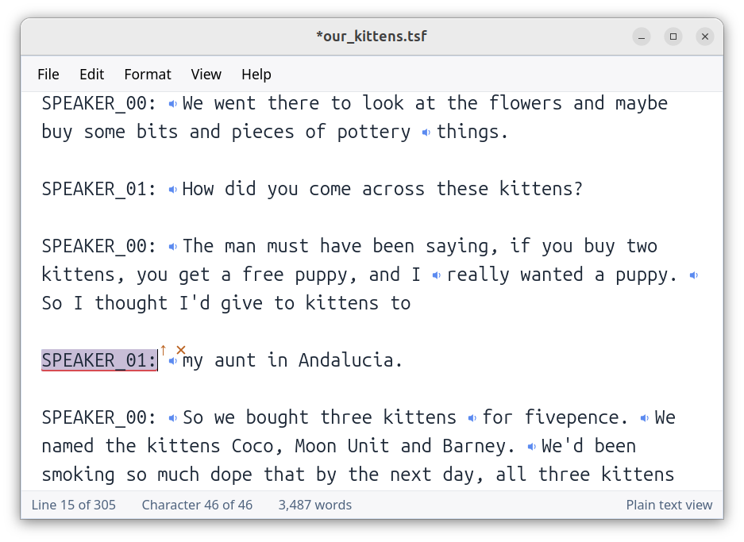

# Wisty

Wisty is a text editor for Linux with a clean look and specialised tools for
reviewing and tidying interview transcripts. It doesn't have code highlighting.
It only handles UTF-8 files and has support for very large files (streamed
read/write, and will attempt to open files up to 1 GB).

Wisty was originally a fork of [Parchment](https://github.com/tywil04/parchment) but has been completely rewritten in Typescript using AI tools.



Wisty has a basic Formatted mode for displaying styled markdown and also has spell-checking options.

## Linux only

Wisty is a Linux application and there are no plans to port it to Windows or macOS.

## Features

- **Markdown-style formatting** — bold (`**text**`), italic (`*text*` / `_text_`) and ATX headings (`#` .. `######`) are recognised and can be shown either as raw markup ("Plain" view) or with the markers hidden and the content styled ("Formatted" view).
- Text wrapping, adjustable font, light/dark theme, spell check with installable dictionaries.

## Interview transcription workflow

Wisty can import a timed transcript in **WebVTT (`.vtt`) or SRT (`.srt`)
format together with its audio recording**. Each timed cue is associated with
the corresponding text, and Wisty saves the transcript and audio together in a
single `.tsf` file. Speaker information is preserved when it is supplied in
WebVTT voice spans; SRT does not have a standard way to carry speaker names.

When a `.tsf` file is open, speaker icons beside the transcript text play the
audio associated with individual passages. This makes it quick to listen to an
unclear phrase while correcting the transcript, without finding the same point
manually in a separate audio player.

Wisty does not transcribe recordings itself. A local speech-to-text model or
another transcription tool can be used to produce the timed VTT or SRT file
before importing it into Wisty.

### Transcript Mode

**View → Transcript Mode** provides a fast mouse-driven way to tidy speaker
turns. It is intended for transcripts whose lines begin with speaker labels such
as `ALICE:` and `BOB:`.

- Hover over a word to select it.
- Use the mouse wheel while hovering to expand or contract the selection one
  word at a time.
- Left-click the highlighted words to apply an action determined by their
  position in the current speaker turn (the labelled line):
  - a selection at the beginning moves to the end of the preceding speaker's
    turn
  - a selection at the end moves to the beginning of the following speaker's
    turn
  - a selection in the middle splits the current turn into three, placing the
    selected words in a new turn attributed to the other speaker
- Hover over a speaker label and left-click it to merge that turn into the turn
  above, or right-click it to delete the whole turn.
- The colour and symbol beside a selection preview which action a click will
  perform. Press `Escape` to clear the transient selection without making an
  edit.

These clicks modify the document, so check the indicated action before clicking.
Normal undo remains available if a correction is not what you intended.

Transcript Mode is designed primarily for interviews with two speakers. For a
middle split, Wisty uses the document's other speaker as the new turn's label.
If a transcript does not contain exactly two speakers, Wisty only performs the
split when an adjacent turn provides a different speaker label; otherwise the
selection is left unchanged.

## Installation

Download v2.5.0 or newer from
[GitHub Releases](https://github.com/minntylabs/wisty/releases). Do not install
an older release. Releases before v2.5.0 are retained for historical purposes
but are unsupported and predate dependency security updates.

### User-only install

The user-install tarball does not require `sudo`. Download
`wisty-user-install-<version>-linux-<arch>.tar.gz`, then run:

```bash
tar -xzf wisty-user-install-*.tar.gz
cd wisty-user-install-*
./install.sh
```

It installs:

- the executable to `~/.local/bin/wisty`
- the desktop entry to `~/.local/share/applications/wisty.desktop`
- icons under `~/.local/share/icons/hicolor/`

If `~/.local/bin` is not already on your `PATH`, the installer offers to add it.
The extracted directory also contains `uninstall.sh`.

### Other packages

The release also provides `.deb`, `.rpm`, and `.AppImage` packages. All of these
require the Linux runtime libraries listed below; the `.deb` and `.rpm` packages
declare those dependencies for their package managers.

### Build from source

After installing the [build prerequisites](#build-prerequisites-from-source),
run:

```bash
npm ci
npm run tauri -- build
npm run package:user-tarball
```

The packaging command prints the path of the generated archive and leaves its
contents in `dist-user/wisty-user-install-<version>-linux-<arch>/`. Run
`install.sh` from that directory.

## Linux runtime libraries

Wisty requires **WebKitGTK 4.1**, **GTK 3**, and the **ALSA runtime library**.
ALSA is used for transcript audio playback. The AppImage and user-install
tarball use the copies supplied by the operating system rather than bundling
these libraries.

You may already have these, if not, install them like this:

### Ubuntu / Debian

```bash
sudo apt install -y libwebkit2gtk-4.1-0 libgtk-3-0 libayatana-appindicator3-1
```

For ALSA, install `libasound2t64` on Ubuntu 24.04 and newer:

```bash
sudo apt install -y libasound2t64
```

On Debian and older Ubuntu releases, install `libasound2` instead:

```bash
sudo apt install -y libasound2
```

### Fedora

```bash
sudo dnf install -y webkit2gtk4.1 gtk3 libappindicator-gtk3 alsa-lib
```

### Arch Linux

```bash
sudo pacman -S --needed webkit2gtk-4.1 gtk3 libappindicator-gtk3 alsa-lib
```

## Build prerequisites (from source)

If you are building wisty from source, you will also need development packages.

Two of these are easy to miss, because neither failure names a package. Spell
check binds to hunspell through bindgen, which needs libclang at build time and
fails as a bindgen error. Transcript playback binds to ALSA through rodio, which
needs the ALSA development headers and fails as a linker error from alsa-sys.
The runtime ALSA library is on every desktop already; only the headers are
missing by default. Both are included below.

### Ubuntu / Debian

```bash
sudo apt install -y build-essential pkg-config libssl-dev libgtk-3-dev libwebkit2gtk-4.1-dev libayatana-appindicator3-dev librsvg2-dev libclang-dev libasound2-dev
```

### Fedora

```bash
sudo dnf install -y gcc gcc-c++ make pkgconf-pkg-config openssl-devel gtk3-devel webkit2gtk4.1-devel libappindicator-gtk3-devel librsvg2-devel clang-devel alsa-lib-devel
```

### Arch Linux

```bash
sudo pacman -S --needed base-devel pkgconf openssl gtk3 webkit2gtk-4.1 libappindicator-gtk3 librsvg clang alsa-lib
```

## Build and run

From the project root:

```bash
npm run tauri -- dev
```

Build Linux release artifacts:

```bash
npm run tauri -- build
```

## Documentation

- [The `.tsf` transcript container](docs/tsf-format.md) — the interview
  transcript format, its time markers, and where `.tsf` files come from.
- [A WebKitGTK crash when an editor contains an image](docs/webkitgtk-accessibility-crash.md)
  — a browser bug this ran into, written up for anyone building a rich-text
  editor on WebKitGTK.

## Open source libraries used

Many thanks to the developers of these libraries which are used in this project.

### App framework and runtime

- [Tauri](https://github.com/tauri-apps/tauri)
- [WebKitGTK](https://webkitgtk.org/)
- [GTK](https://www.gtk.org/)

### Tauri plugins

- [plugin-dialog](https://github.com/tauri-apps/plugins-workspace/tree/v2/plugins/dialog)
- [plugin-fs](https://github.com/tauri-apps/plugins-workspace/tree/v2/plugins/fs)
- [plugin-store](https://github.com/tauri-apps/plugins-workspace/tree/v2/plugins/store)
- [plugin-log](https://github.com/tauri-apps/plugins-workspace/tree/v2/plugins/log)
- [plugin-clipboard-manager](https://github.com/tauri-apps/plugins-workspace/tree/v2/plugins/clipboard-manager)

### Frontend and editor

- [SolidJS](https://github.com/solidjs/solid)
- [CodeMirror 6](https://github.com/codemirror/dev)

### Tooling

- [Vite](https://github.com/vitejs/vite)
- [vite-plugin-solid](https://github.com/solidjs/vite-plugin-solid)

## Credits

- Original project: [Parchment](https://github.com/tywil04/parchment)
